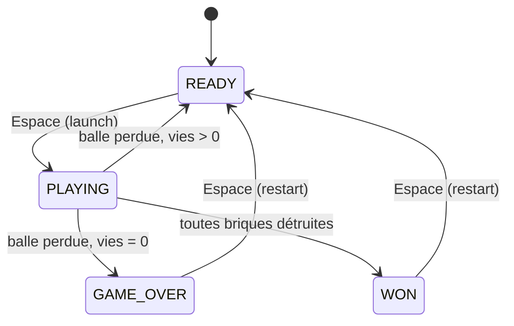

# ARCHITECTURE : Breakout

- **Liée à** : [SPEC.md](./SPEC.md)
- **Dernière mise à jour** : 04 novembre 2026

## 1. Vue d'ensemble
Une scène principale (`Main`) orchestre la partie : elle instancie l'arène,
écoute les signaux des objets de jeu et pilote les états (start, playing,
game over, victoire). 

Les objets de jeu (raquette, balle, briques) ne se
connaissent pas entre eux : ils émettent des signaux, `Main` décide.

## 2. Arborescence du projet

```
res://
├── scenes/
│   ├── main.tscn
|   ├── arena.tscn
|   ├── paddle.tscn
|   ├── ball.tscn
|   ├── brick.tscn
|   ├── brick_grid.tscn
│   └── hud.tscn
├── scripts/
|   ├── main.gd
|   ├── paddle.gd
|   ├── ball.gd
|   ├── brick.gd
|   ├── brick_grid.gd
│   └── hud.gd
├── assets/
│   ├── art/
│   └── audio/
├── docs/
|   ├── SPEC.md
|   ├── ARCHITECTURE.md
|   └── RETRO.md
└── README.md
```


## 3. Arbre des scènes

```
Main (Node)
├── Arena (Node2D)
│   ├── Walls (StatickBody2D)
│   └── DeathZone (Area2D)
├── Paddle (CharacterBody2D)
├── Ball (CharacterBody2D)
├── BrickGrid (Node2D)
|   └── Brick (StaticBody2D)
├── HUD (CanvasLayer)
|   ├── ScoreLabel
|   ├── LivesLabel
|   └── Message
├── PaddlePosition
└── Timers
```

## 4. Scripts et responsabilités

| Scène | Script | Responsabilité (1 phrase) | Ne doit PAS |
|-------|--------|---------------------------|-------------|
| Main | `main.gd` | Orchestre la partie et l'état du jeu | Gérer la physique de la balle |
| Paddle | `paddle.gd` | Se déplace selon l'input, bloquée aux bords | Connaître la balle |
| Ball | `ball.gd` | Se déplace à vitesse constante et rebondit | Gérer score ou vies |
| Brick | `brick.gd` | Se détruit quand on la touche et prévient | Mettre à jour le score |
| BrickGrid | `brick_grid.gd` | Génère le mur et compte les briques restantes | Connaître le score |
| HUD | `hud.gd` | Affiche score, vies et messages | Calculer quoi que ce soit |
| DeathZone | (signal seul) | Détecte la balle sortie par le bas | Décider de la perte de vie |


## 5. Communication entre composants

### Signaux

| Émetteur | Signal | Récepteur | Effet |
|----------|--------|-----------|-------|
| Brick | `destroyed(points)` | BrickGrid | Décrémente le compteur, relaie |
| BrickGrid | `brick_destroyed(points)` | Main | Ajoute les points au score |
| BrickGrid | `all_bricks_destroyed` | Main | Passe à l'état WON |
| DeathZone | `body_entered` (signal natif) | Main | Retire une vie |
| Main | appelle `hud.update_score()`, `hud.update_lives()`, `hud.show_message()` | HUD | Affichage |
| Main | appelle `ball.launch()`, `ball.reset(position)` | Ball | Lancement / replacement |

## 6. Flux de scénarios clés

**Scénario A : la balle touche une brique**
1. `Ball` détecte la collision via `move_and_collide()`.
2. `Ball` rebondit (`velocity.bounce(normal)`).
3. Si le collider a une méthode `hit()`, `Ball` l'appelle.
4. `Brick.hit()` émet `destroyed(points)` puis se `queue_free()`.
5. `BrickGrid` décrémente son compteur et émet `brick_destroyed(points)`.
6. `Main` ajoute les points puis appelle `hud.update_score()`.
7. Si le compteur est à 0, `BrickGrid` émet `all_bricks_destroyed` puis `Main` passe en WON.

**Scénario B : la balle tombe**
1. La balle entre dans `DeathZone` puis `Main` reçoit le signal.
2. `Main` retire une vie puis appelle `hud.update_lives()`.
3. S'il reste des vies : `ball.reset()` et retour à l'état READY.
4. Sinon : état GAME_OVER.

**Scénario C : rebond sur la raquette**
1. `Ball` détecte que le collider est dans le groupe `paddle`.
2. Calcul de l'angle selon la distance entre le point d'impact et le centre de la raquette.
3. La direction est remplacée (pas un simple `bounce`), la vitesse reste constante.

## 7. Machine à états du jeu

États : `READY` (balle sur la raquette), `PLAYING`, `GAME_OVER`, `WON`.
Propriétaire : `Main` (variable `state` + `enum`).




# 8. Données et constantes

| Donnée | Où | Valeur v1 |
|--------|----|-----------|
| score, lives | main.gd (variables) | 0 / 3 |
| Vitesse de la balle | ball.gd (`@export`) | à régler |
| Vitesse de la raquette | paddle.gd (`@export`) | à régler |
| Angle max de rebond raquette | ball.gd (`@export`) | ~60° |
| Grille de briques (colonnes, lignes, taille, espacement) | brick_grid.gd (`@export`) | ex. 10 × 5 |
| Points par brique | brick.gd (`@export`) | 10 |

## 9. Autoloads (singletons)

| Autoload | Justification | Risque (état global) |
|----------|---------------|----------------------|
| Aucun par défaut | | |


## 10. Input Map

| Action | Touches |
|--------|---------|
| `move_left` | Flèche gauche |
| `move_right` | Flèche droite |
| `launch` | Espace |

## 11. Groupes et couches de collision

| Groupe | Membres | Usage |
|--------|---------|-------|
| `paddle` | Paddle | Ball identifie la raquette |
| `bricks` | Brick | Comptage éventuel |

| Layer | Nom | Contient | Détecte (mask) |
|-------|-----|----------|----------------|
| 1 | walls | Walls | |
| 2 | paddle | Paddle | walls |
| 3 | ball | Ball | walls, paddle, bricks |
| 4 | bricks | Brick | |
| 5 | death | DeathZone | ball |


## 12. Décisions d'architecture


| Date | Décision | Alternatives | Raison |
|------|----------|--------------|--------|
| 04/11 | Balle en `CharacterBody2D` + `move_and_collide` | `RigidBody2D` | Contrôle total de la vitesse et du rebond |
| 04/11 | `Main` détient score/vies | Autoload `GameState` | Éviter l'état global (v1) |
| 04/11 | La brique émet un signal, ne touche pas au score | Brique modifie `Main` directement | Découplage, brique réutilisable |
| 04/11 | Pas de `Resource` en v1 | `BrickData` Resource | Hors besoin v1, à voir en v2 |
